

# NÜMA

### Reproductor de música para Android y Windows

Un reproductor para **Android y Windows**, con biblioteca de YouTube Music,
letras sincronizadas, escucha sin conexión y Salas Compartidas.

**[Descargar](https://github.com/andyhenriquezluciano/Numa/releases/latest)** ·
**[Windows](#windows)** · **[Android](#android)** · **[Sincronización](#sincronización-entre-pc-y-android)** · **[Instalación](#instalación)** ·
**[Reportar un problema](https://github.com/andyhenriquezluciano/Numa/issues/new/choose)**

La disponibilidad depende del contenido, la plataforma, la conexión y los servicios vinculados.
NÜMA no proporciona suscripciones ni elimina los requisitos de los proveedores.

## Funciones

| Apartado | Qué puedes hacer |
| --- | --- |
| **Biblioteca y listas** | Guarda canciones, artistas y álbumes. Organiza tus listas y elige sus carátulas. |
| **Letras y traducción** | Sigue la letra mientras suena y tradúcela al español o al inglés. |
| **Audio y mezclas** | Ajusta el ecualizador, el fundido cruzado y la mezcla adaptativa. Usa Mejor mezcla para ordenar la cola. |
| **Descargas y archivos locales** | Guarda música para escuchar sin conexión o añade tus propios archivos. |
| **Vídeos y carátulas** | Abre vídeos musicales y disfruta de carátulas animadas cuando estén disponibles. |
| **Personalización** | Elige entre Cristal y Rosé Pine, configura los bordes y adapta el reproductor. |
| **Métricas** | Consulta lo que más escuchas, el tiempo de reproducción y tus artistas y álbumes favoritos. |
| **Salas y sincronización** | Escucha en compañía y conserva tu biblioteca en PC y Android con tu cuenta NÜMA. |

## Windows

### Funciones de escritorio

- Biblioteca de YouTube Music con canciones, artistas, álbumes y listas.
- Archivos locales integrados en la biblioteca.
- Reproductor a pantalla completa, letras sincronizadas y traducción según disponibilidad.
- Vídeos musicales con controles de reproducción y selección de calidad.
- Carátulas animadas, fondos y personalización con temas Cristal y Rosé Pine.
- Salas Compartidas con Android, para escuchar en compañía.

### Inicio y biblioteca

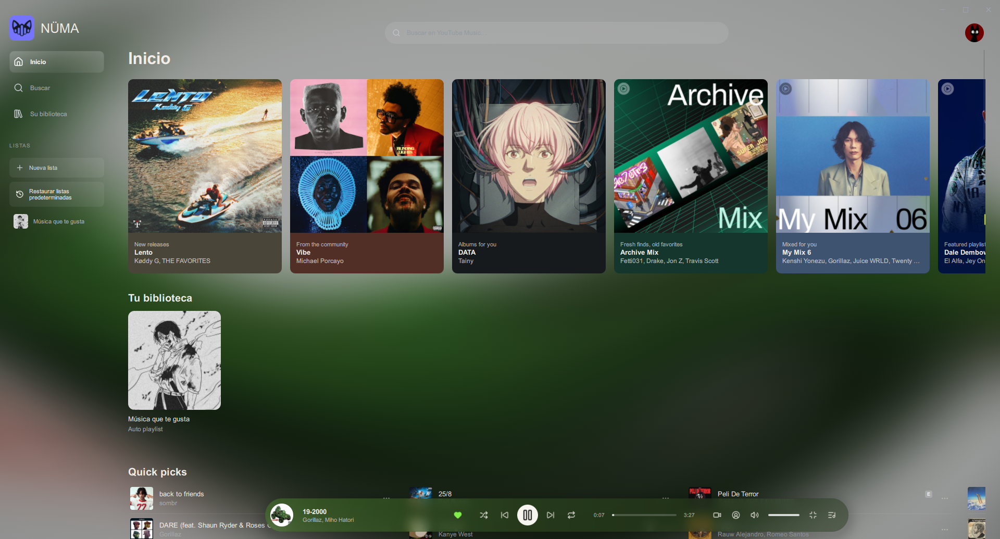

<table>
  <tr>
    <td width="50%">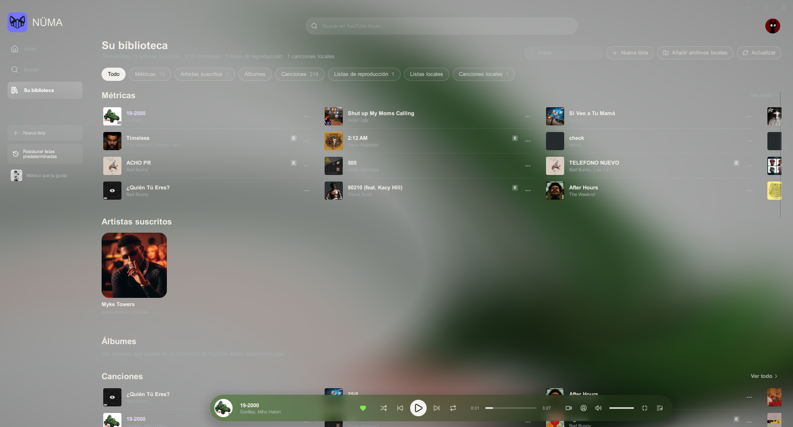</td>
    <td width="50%">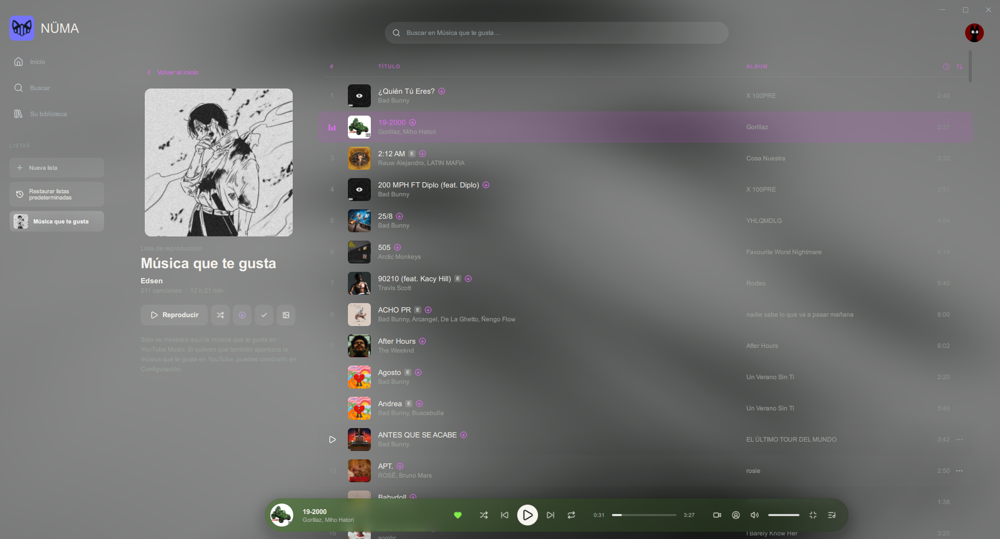</td>
  </tr>
  <tr>
    <td align="center">Biblioteca</td>
    <td align="center">Tus listas</td>
  </tr>
  <tr>
    <td>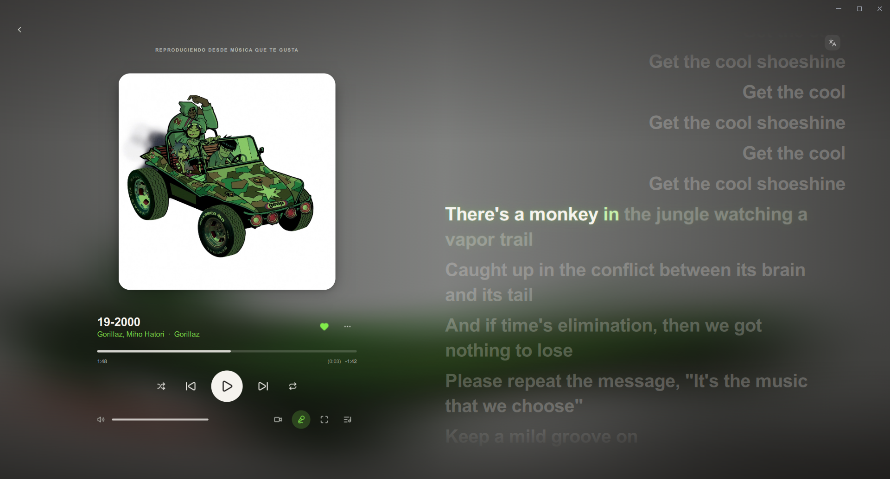</td>
    <td>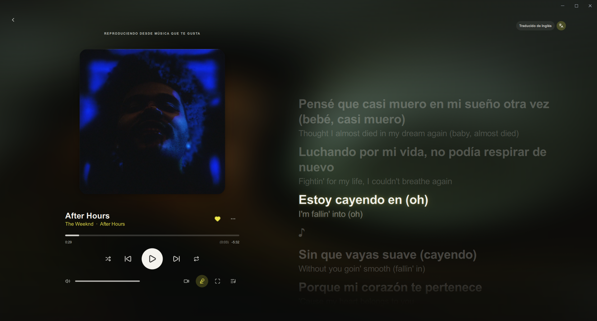</td>
  </tr>
  <tr>
    <td align="center">Letras sincronizadas</td>
    <td align="center">Traducción de letras</td>
  </tr>
</table>

### Carátulas animadas en Windows

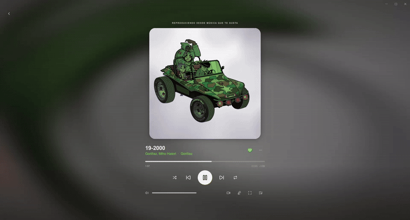

Las carátulas animadas y los fondos acompañan la reproducción cuando el contenido está disponible.
Esta demostración utiliza una grabación real de la aplicación, convertida a GIF sin sonido.

### Vídeo en Windows

Vídeos musicales en la interfaz de escritorio, con controles y selección de calidad
según la disponibilidad del contenido.

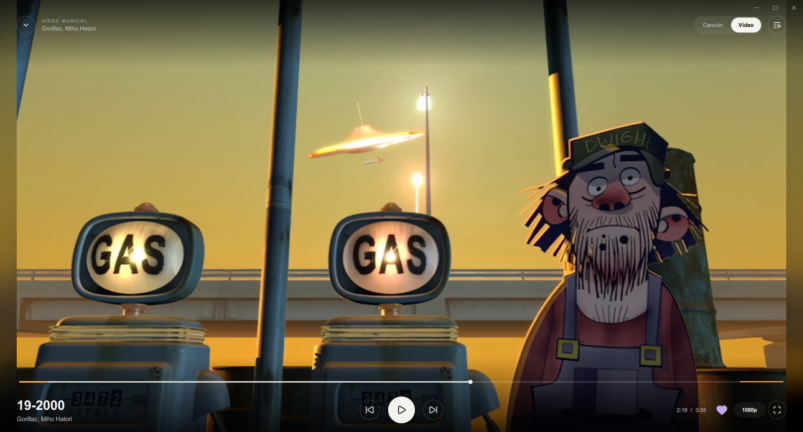

### Reproductor compacto

<table>
  <tr>
    <td width="33%">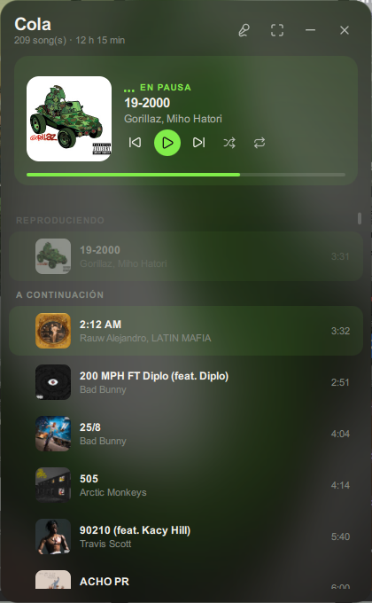</td>
    <td width="33%">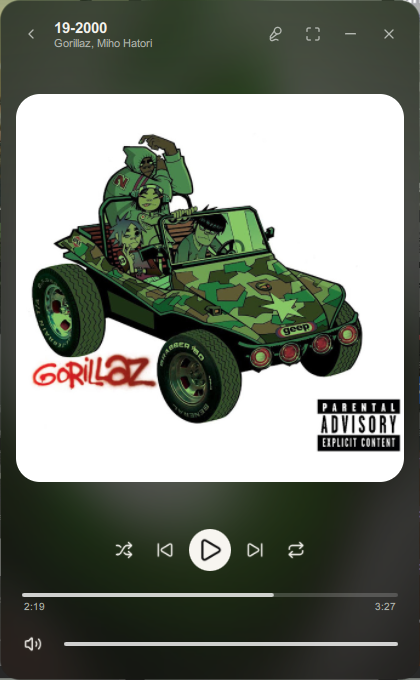</td>
    <td width="33%">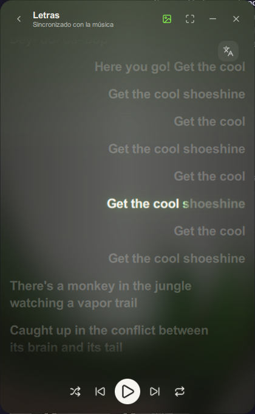</td>
  </tr>
</table>

## Android

### Funciones móviles

- Navegación por Inicio, Biblioteca, Salas y Ajustes.
- Canciones sin conexión y notificación del progreso de descarga.
- Listas con carátulas personalizadas o automáticas y opción Mejor mezcla.
- Letras sincronizadas y traducción según disponibilidad.
- Ecualizador, transiciones, temas y estilos de bordes.
- Vídeos musicales en horizontal y acceso a Chromecast.
- Pantalla de bloqueo con controles, letras y carátulas animadas.
- Salas Compartidas con Windows, para escuchar en compañía.

### Reproductor, listas y letras

Biblioteca, listas con carátulas automáticas y letras sincronizadas con traducción.

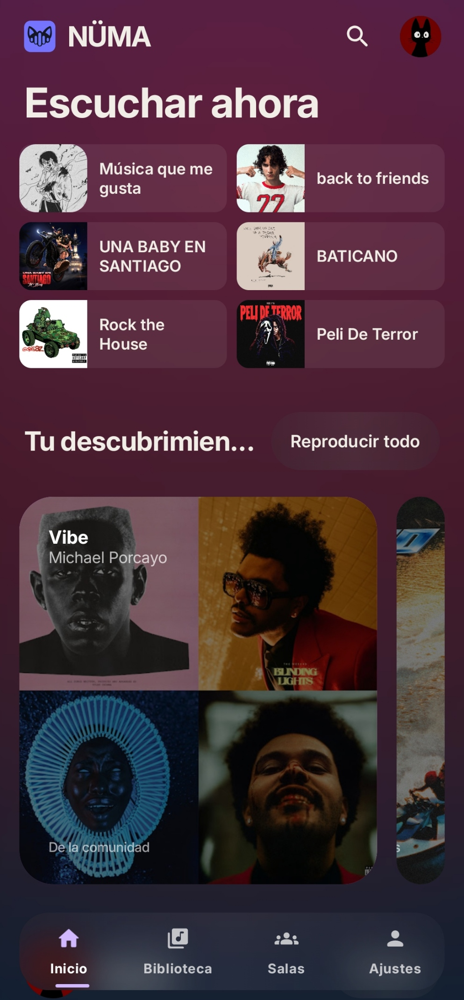

Inicio de NÜMA en Android.

<table>
  <tr>
    <td width="25%">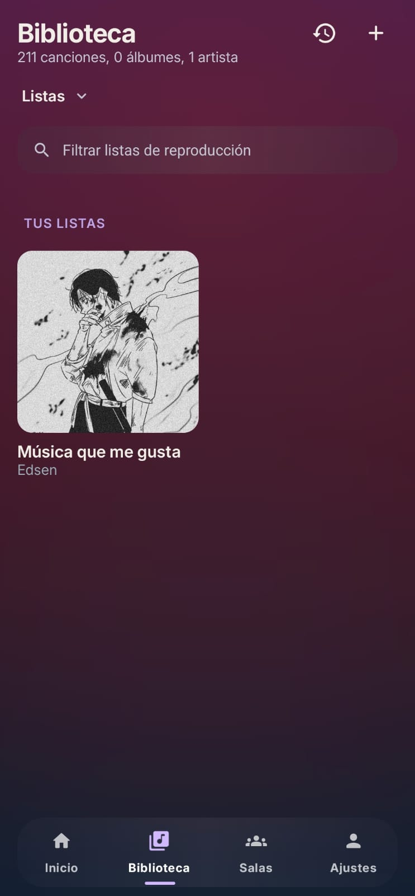</td>
    <td width="25%">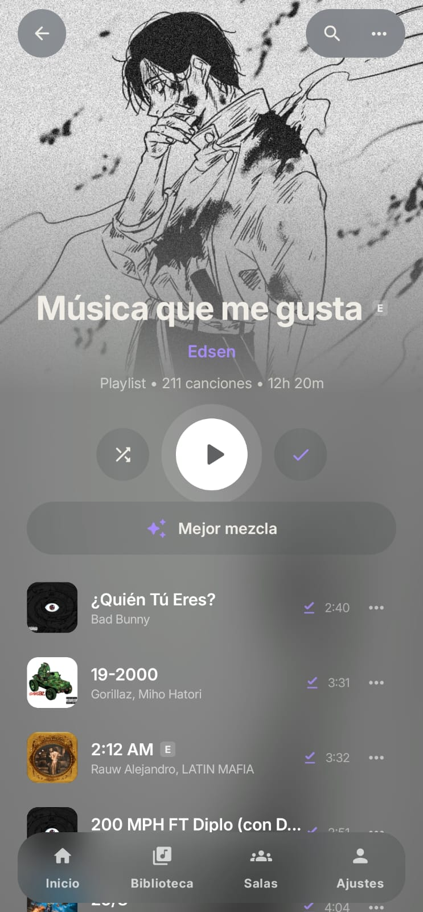</td>
    <td width="25%">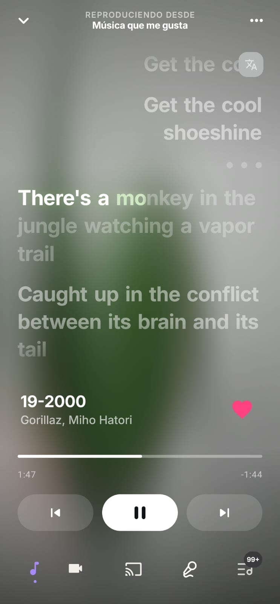</td>
    <td width="25%">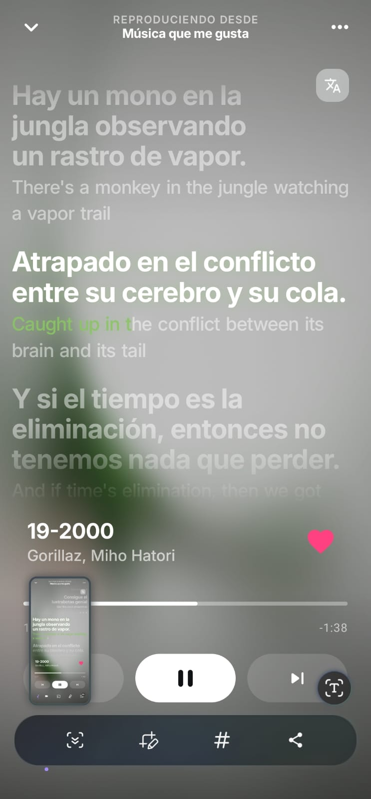</td>
  </tr>
  <tr><td align="center">Biblioteca</td><td align="center">Tus listas</td><td align="center">Letras sincronizadas</td><td align="center">Letras traducidas</td></tr>
</table>

### Vídeo en Android

Reproducción en horizontal con controles y selección de calidad según la disponibilidad
del contenido.

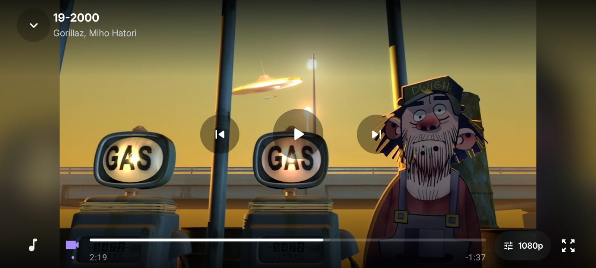

### Pantalla de bloqueo en Android

Controles de reproducción, letras y carátulas animadas sin salir de la pantalla de bloqueo.
Grabaciones reales convertidas a GIF sin sonido.

<table>
  <tr>
    <td width="50%" align="center">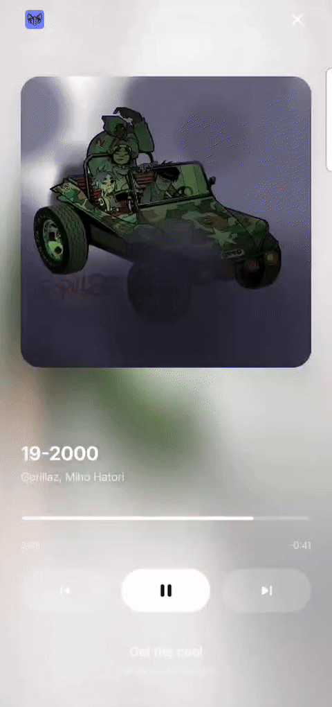</td>
    <td width="50%" align="center"></td>
  </tr>
  <tr><td align="center">Tamaño normal</td><td align="center">Carátula completa</td></tr>
</table>

### Carátulas animadas en Android

<table>
  <tr>
    <td width="50%" align="center">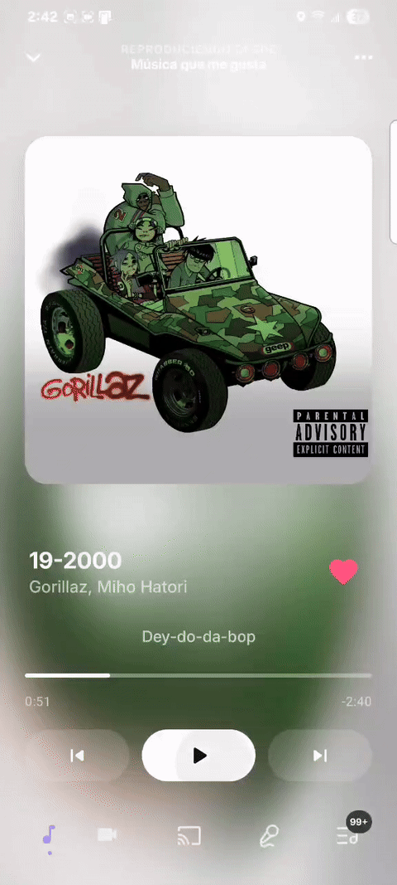</td>
    <td width="50%" align="center"></td>
  </tr>
  <tr><td align="center">Tamaño normal</td><td align="center">Completa</td></tr>
</table>

## Sincronización entre PC y Android

Tu biblioteca va contigo. Entra con la **misma cuenta NÜMA de Google** en ambos dispositivos y tus listas, carátulas, favoritos, artistas, álbumes y métricas se mantendrán sincronizados.

Los cambios se sincronizan automáticamente. Si quieres comprobarlos al momento, pulsa **Sincronizar ahora** en Ajustes.

Las canciones descargadas se quedan en cada dispositivo. La cuenta NÜMA es independiente de la sesión de YouTube Music.

## Salas Compartidas

Crea una sala y comparte su código para escuchar con otras personas desde PC o Android. El anfitrión puede cambiar de canción y ceder el control.

Cada participante usa su propia conexión y sesión de YouTube Music. La latencia de reproducción depende de la red y de la salida de audio de cada dispositivo.

## Descargar

Los instalables están en **[la última versión](https://github.com/andyhenriquezluciano/Numa/releases/latest)**.

| Plataforma | Descarga | Requisitos |
| --- | --- | --- |
| **Android 2.2** | [Numa-Android-2.2.apk](https://github.com/andyhenriquezluciano/Numa/releases/download/v2.2/Numa-Android-2.2.apk) | Android 12 o posterior, ARM64 |
| **Windows 2.1** | [Numa-Setup-2.1.0.exe](https://github.com/andyhenriquezluciano/Numa/releases/download/v2.2/Numa-Setup-2.1.0.exe) | Windows x64 |

## Instalación

### Android

Descarga el APK e instálalo sobre la versión que ya tienes para conservar tus datos. Android te pedirá autorizar la instalación desde el navegador o gestor de archivos.

### Windows

Descarga el setup y sigue los pasos del instalador. Puedes actualizar sin desinstalar NÜMA.

## Para tocar el código

Los requisitos y comandos de compilación están en [Desarrollo](docs/DEVELOPMENT.md). Para reportar un problema, indica tu versión, sistema operativo y los pasos para reproducirlo en [Issues](https://github.com/andyhenriquezluciano/Numa/issues).

## Licencia

[AGPL-3.0](LICENSE), [excepciones](LICENSE-EXCEPTION.md), [condiciones adicionales](LICENSE-OOL) y [avisos de terceros](THIRD_PARTY_NOTICES.md).

NÜMA es independiente de los proveedores de contenido. Las marcas, letras y carátulas de las capturas pertenecen a sus titulares.
